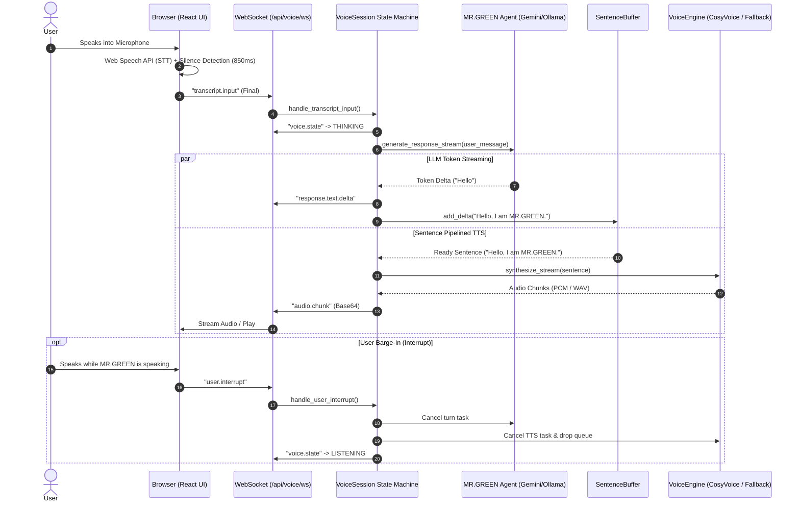

# MR.GREEN Voice Agent — End-to-End System Architecture

This document provides a comprehensive technical breakdown of how the **MR.GREEN Voice Agent** works across the frontend, bidirectional WebSocket transport, agent reasoning engine, Speech-to-Text (STT), streaming Text-to-Speech (TTS), and real-time interruption (barge-in).

---

## 1. High-Level Architecture Overview

MR.GREEN employs a **duplex streaming voice architecture** designed for sub-second conversational latency and natural turn-taking.

---

## 2. Core Architectural Components

### A. Frontend Layer (`frontend/src/`)

| Component / Hook | Source Path | Primary Role |
| :--- | :--- | :--- |
| **`VoiceSocketClient`** | [`voiceSocket.ts`](file:///c:/Users/Admin/Desktop/project/Green/mrgreen/frontend/src/services/voiceSocket.ts) | Manages WebSocket connection, auto-reconnect, Base64 audio chunk accumulation into playable Blobs, and protocol events. |
| **`useSpeechRecognition`** | [`useSpeechRecognition.ts`](file:///c:/Users/Admin/Desktop/project/Green/mrgreen/frontend/src/hooks/useSpeechRecognition.ts) | Wraps `webkitSpeechRecognition` with continuous listening, interim transcript streaming, microphone permission gating, and an **850ms silence debounce timer**. |
| **`useSpeechSynthesis`** | [`useSpeechSynthesis.ts`](file:///c:/Users/Admin/Desktop/project/Green/mrgreen/frontend/src/hooks/useSpeechSynthesis.ts) | Fallback browser-side speech synthesis with automated Markdown/code cleansing for acoustic output when server-side TTS is disabled or offline. |
| **`MrGreenAssistantVisual` & `GreenOrb`** | [`MrGreenAssistantVisual.tsx`](file:///c:/Users/Admin/Desktop/project/Green/mrgreen/frontend/src/components/voice/MrGreenAssistantVisual.tsx) | Futuristic 3D animated visualizer reflecting states: `IDLE`, `LISTENING`, `THINKING`, `SPEAKING`, and `ERROR`. |
| **`BottomVoiceControl`** | [`BottomVoiceControl.tsx`](file:///c:/Users/Admin/Desktop/project/Green/mrgreen/frontend/src/components/voice/BottomVoiceControl.tsx) | Microphone toggle button flanked by audio waveform indicators, with an expandable text input fallback. |

---

### B. Transport & Protocol Layer (`backend/app/voice/`)

Communication takes place over `/api/voice/ws` using structured JSON messages adhering to [`BaseVoiceEvent`](file:///c:/Users/Admin/Desktop/project/Green/mrgreen/backend/app/voice/protocol.py):

#### Voice Lifecycle States:
- `IDLE`: Initial state before activation.
- `CONNECTING` / `CONNECTED`: Handshake complete.
- `LISTENING`: Microphone open; listening for speech.
- `USER_SPEAKING`: User speech detected, streaming partial transcripts.
- `THINKING`: User finished speaking; LLM inference running.
- `ASSISTANT_SPEAKING`: Voice engine streaming synthesized audio.
- `INTERRUPTED`: User spoke over the assistant; output immediately truncated.
- `ERROR`: System fault condition.

#### Protocol Events:
- **Client to Server:** `session.start`, `transcript.input`, `user.interrupt`, `ping`, `session.stop`.
- **Server to Client:** `session.ready`, `voice.state`, `transcript.partial`, `transcript.final`, `response.text.delta`, `audio.start`, `audio.chunk`, `audio.end`, `assistant.interrupted`.

---

### C. Backend Session & State Machine (`backend/app/voice/session.py`)

[`VoiceSession`](file:///c:/Users/Admin/Desktop/project/Green/mrgreen/backend/app/voice/session.py) orchestrates the lifecycle:

1. **Session Scope:** Creates or reuses a persistent `conversation_id` backed by PostgreSQL.
2. **Turn Isolation:** Runs each conversational turn in an isolated `asyncio.Task`.
3. **Pipelined Execution:**
   - LLM generation does **not** wait for audio synthesis to complete.
   - Text chunks pass through [`SentenceBuffer`](file:///c:/Users/Admin/Desktop/project/Green/mrgreen/backend/app/voice/audio/buffer.py). As soon as punctuation (`.`, `?`, `!`, `,`) is encountered, the completed sentence is placed into an `asyncio.Queue`.
   - A concurrent background worker (`_tts_consumer`) consumes sentences from the queue and streams them to the TTS engine chunk-by-chunk.

---

### D. AI Reasoning Engine (`backend/app/ai/`)

MR.GREEN supports dual AI provider backends:

1. **Google Gemini (`GeminiProvider`)**:
   - Model: `gemini-flash-latest` / `gemini-3.8-flash`.
   - Real-time token streaming via Server-Sent Events (SSE).
   - Multi-model resilience: Automatic failover between `gemini-flash-latest`, `gemini-3.5-flash`, and `gemini-3.8-flash` on temporary 503 high-demand spikes.
2. **Ollama (`OllamaProvider`)**:
   - Model: `qwen2.5:3b`.
   - Runs locally when internet access is unavailable.

#### Voice Prompt Addendum:
When in voice mode, the agent appends `VOICE_SYSTEM_PROMPT_ADDENDUM`:
- Enforces concise, natural phrasing (1 to 2 spoken sentences).
- Strips markdown formatting, code blocks, bullet points, asterisks, and emojis to ensure natural acoustics.

---

### E. Speech-to-Text (STT) Subsystem

- **Primary (Client-Assisted):** Native Web Speech API on the browser/mobile device. Provides low-latency transcription and offloads computation from the VPS.
- **Interim Streaming:** As the user speaks, partial results are broadcast to the server, shifting state to `USER_SPEAKING`.
- **End-of-Speech Detection:** An automated silence debounce timer (850ms) triggers the final transcript submission without requiring manual button clicks.

---

### F. Text-to-Speech (TTS) Subsystem

- **Voice Orchestrator:** [`VoiceEngine`](file:///c:/Users/Admin/Desktop/project/Green/mrgreen/backend/app/voice/tts/engine.py).
- **CosyVoice Provider:** [`CosyVoiceProvider`](file:///c:/Users/Admin/Desktop/project/Green/mrgreen/backend/app/voice/tts/cosyvoice.py).
  - Target Voice Profile: `GREEN_DEFAULT` (cloned from `green.wav`).
  - Native Multi-lingual: Automatically detects English vs. Tamil (`detect_language()`).
  - Fallback Mode: When the heavy neural CosyVoice model is not loaded in VPS memory, the server signals the frontend via `session.ready` (`tts_available: false`). The frontend seamlessly switches to client-side Web Speech Synthesis, ensuring zero downtime.

---

### G. Barge-In & Interruption Handling

One of MR.GREEN's most critical features is instant interruption:
1. When user speech is detected or the user clicks the microphone during playback:
   - Client immediately sends `user.interrupt` over WebSocket.
   - Client calls `window.speechSynthesis.cancel()` and halts any playing audio elements.
2. Server executes `handle_user_interrupt()`:
   - Cancels the active LLM inference task (`_current_turn_task.cancel()`).
   - Cancels the active TTS synthesis task (`_current_tts_task.cancel()`).
   - Clears the pending sentence queue.
   - Emits `assistant.interrupted` and returns state immediately to `LISTENING`.

---

## 3. Summary of Latency Optimizations

| Optimization | Implementation Detail | Benefit |
| :--- | :--- | :--- |
| **Sentence-Pipelined TTS** | `SentenceBuffer` splits tokens as they arrive from LLM | Audio starts playing on sentence 1 while LLM is still drafting sentence 2 |
| **SSE LLM Streaming** | `streamGenerateContent?alt=sse` in `GeminiProvider` | Time-to-first-token (TTFT) reduced to ~300-500ms |
| **Client-Side STT** | Web Speech API directly in user browser | Zero server STT latency and zero audio upload bandwidth |
| **Automatic TTS Fallback** | `session.ready` informs frontend of TTS engine status | Instant speech output even on low-spec VPS environments |
